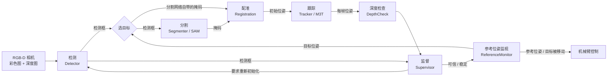

# 模块的业务逻辑

本文说明每个模块做什么、按什么顺序做、为什么这样做、什么情况下判为失败，以及失败后怎么办。读完后，你应该能判断某个现象该去哪个模块找原因，改哪个参数会影响什么。实现细节以代码为准，这里只写逻辑。为什么选这些方法，见 [decisions.md](decisions.md)。

每个模块按同样的顺序介绍：作用、输入、步骤、判断条件、失败时、输出、测试。

## 总览

### 取矿时谁在什么时候做什么

1. 操作手把机器人停在矿站前，把相机画面的准心对准要取的能量单元，按下按钮。
2. 机械臂摆到观察姿态后静止。视觉开始初始化：检测、取掩码、配准，配准通过后启动跟踪。
3. 跟踪连续可信一段时间（默认 15 帧，约 0.5 s）后，流程给出“跟踪稳定”信号。参考位姿监视把这一刻的位姿换到机械臂底座坐标系，存为参考位姿。
4. 机械臂按参考位姿接近、抓取、拉出。途中视觉继续跟踪，用来核对单元有没有被碰动。
5. 核对发现单元被碰动时，机械臂停下，回到第 2 步原地重新初始化。

夹住之前，目标静止在中心块上，所以机械臂按参考位姿运动就能抓到它。视觉在接近阶段的任务是核对，不是给机械臂提供每一帧的目标。接近末段夹爪会挡住目标，那几帧视觉看不清，按“弱证据”处理，不打断机械臂。这样设计的原因见 [decisions.md](decisions.md) 的“取矿流程”一节。

### 数据流

`pipeline::Pipeline` 把检测到监督这一段串起来，每帧调用一次。参考位姿监视在它之后，需要相机到底座的位姿，所以由调用方单独调用。

### 两个状态

流程只有两个状态：

- **搜索**：还没有可用的位姿。每帧检测、取掩码、配准。配准通过就进入跟踪。
- **跟踪**：每帧由 M3T 从上一帧的位姿算出新位姿，再由监督判断是否可信。监督要求重新初始化时，回到搜索。

两个状态的耗时差几个数量级。配准在 CPU 上要几百毫秒，被拒绝时要约 3 s；M3T 一帧不到 1 ms。所以完整的配准只在需要时做，平时靠跟踪。

## 公共约定

- **位姿**：mesh 到相机的刚体变换（`Eigen::Isometry3d`），单位 m，OpenCV 相机坐标系（x 右、y 下、z 前）。
- **能量单元的坐标系**：原点在 mesh 的包围盒中心，z 轴沿长轴指向封闭端（Ø95 的一端）。能量单元绕长轴近似 3 重对称，绕 z 轴的转角看不准，所以 x、y 轴的方向没有意义。使用方只能用原点和 z 轴。
- **mesh**：`meshes/energy_unit.stl`，单位 mm。`geometry::load_binary_stl` 读入时换成 m，并把原点移到包围盒中心。
- **相机参数**：分辨率、内参和深度单位只有一份（`geometry::Camera`），所有模块共用。组件的参数里没有默认值，缺了就启动失败，避免用错误的内参静默运行。
- **图像**：彩色图 `CV_8UC3`（BGR），深度图 `CV_16UC1`，0 表示没有深度。深度图必须已对齐到彩色图：两者分辨率相同，共用一组内参。这样彩色图上的检测框和掩码可以直接用在深度图上。
- **掩码**：`CV_8UC1`，与图像同尺寸，目标像素为 255。检测网络和 SAM 输出的掩码格式相同。

## 检测

`detection::Detector`，代码在 `src/detection/`。

**作用**：在彩色图中找出能量单元，给出检测框和得分。网络是分割网络时，同时给出每个检测的掩码。

**输入**：一帧彩色图。

**步骤**：

1. 把图像等比缩放到 640 × 640 以内，四周用灰色填充（letterbox）。网络的输入尺寸是固定的。
2. 用 OpenVINO 在 CPU 上推理。推理精度固定为 f32。OpenVINO 在支持 bf16 的 CPU 上默认用 bf16，结果会随 CPU 型号变化。
3. 按网络的输出判断网络类型：一个 `[1, 5, 8400]` 的输出是检测网络；`[1, 37, 8400]` 加 `[1, 32, 160, 160]` 是分割网络。不是这两种时，初始化失败。
4. 解码：丢掉得分低于 0.25 的候选，用 NMS（IoU 0.7）去掉重复的框，再把框从 640 × 640 的坐标换回原图坐标。
5. 分割网络还要解码掩码，只对 NMS 之后留下的检测做。37 个属性里的后 32 个是掩码系数，与 32 张 160 × 160 的原型相乘，得到 logit 图。取出未填充区域对应的部分，缩放到原图尺寸，logit 大于 0 的像素为目标，框外的像素清零。做法与 Ultralytics 的 `process_mask_native` 相同。

**判断条件**：得分阈值 0.25，NMS 阈值 0.7（`Detector::Config`）。

**失败时**：初始化失败返回错误（网络文件不存在、输出格式不对）。推理本身不会失败，没有目标时返回空列表。

**输出**：检测框、得分，分割网络还有掩码。交给流程选择目标；跟踪状态下交给监督，与投影框比较。

**耗时**：Ryzen 9600X 上推理约 10 ms，掩码解码约 1 ms。

**测试**：`test_detection` 用手工构造的输出张量测试解码（两种网络格式、宽图和高图的坐标映射、NMS、掩码区域、框外清零），不需要网络文件。`energy_unit_detect` 工具可以在图片上运行检测并画出结果。

## 分割

`segmentation::Segmenter`，代码在 `src/segmentation/`。它是检测网络自带掩码之外的另一个掩码来源，由流程的 `mask_source` 选择。

**作用**：以检测框为提示，分出目标能量单元的掩码。

**为什么需要掩码**：在中心块上，检测框里除了目标，还有中心块和相邻的单元。这些点会让配准的内点率达不到要求，只用检测框时配准几乎每次都被拒绝。

**输入**：一帧彩色图和一个检测框。

**步骤**：

1. 编码器处理整幅图像：长边缩放到 1024，按官方的均值和方差归一化，右下补零。这一步最慢，Ryzen 9600X 上约 1.1 s。
2. 解码器以检测框为提示，输出 4 个候选掩码，每次约 5 ms。
3. 在第 1～3 个候选中取预测 IoU 最高的一个。第 0 个候选偶尔只分出端盖这样的局部。这个选法与官方 ONNX 部署代码对框提示的选法相同。

**失败时**：返回空。流程这一帧不配准，下一帧再试，不会退回只用检测框。

**输出**：掩码，交给配准。

**注意**：SAM 只在检测框内工作。框只包住一部分时，掩码也只覆盖那一部分。

**测试**：`test_segmentation` 在 C++ 渲染的中心块场景上测试：SAM 掩码与真值的 IoU 中位数不低于 0.9、最低不低于 0.85，用 SAM 掩码配准的成功率不低于 90%。找不到 SAM 网络时跳过。

## 深度检查

`registration::DepthCheck`，代码在 `src/registration/depth_check.*`。配准用它验收候选位姿，监督用它判断跟踪结果。

**作用**：判断一个位姿与实测深度是否吻合。

**为什么不只看点是否落在模型上**：任何比能量单元小的表面，点都能落在模型上，内点率照样很高。所以要反过来检查：模型按这个位姿应该出现的地方，相机是否真的看到了它。

**输入**：深度图、相机参数、一个 ROI、可选的掩码、待检查的位姿。

**步骤**：

1. 把 mesh 按位姿渲染成 ROI 内的深度图。渲染轮廓向内腐蚀 2 px，去掉边缘上的混合深度。
2. 逐像素比较实测深度和渲染深度，只看有实测深度的像素：
   - **支持**：两者相差小于 5 mm；
   - **空闲空间违例**：实测更远，即模型本该挡住视线的地方，相机看到了后面的背景；
   - **遮挡**：实测更近，即模型前面有别的东西。
3. 统计三类像素各占有效像素的比例。

**掩码的作用**：有掩码时，掩码外的像素属于别的东西。深度相同或更近都说明不了位姿对错，所以不统计；但掩码外看到比模型更远的背景，说明模型所在处是空的，仍记为违例。这样加了掩码，检查不会变松。

**遮挡计入分母**：否则一个整体落在真实表面后面的错误位姿，只剩少数像素参与统计，也能拿到很高的支持率。

**另外两个函数**：

- `projected_box`：位姿下 mesh 投影的包围框。监督用它做 ROI，并与检测框比较。
- `end_observed_ratios`：mesh 两端（离中心超过半长一半的部分，两端各 1/4 长度）各有多少像素被观测到。被观测到的像素要在画面内、有有效深度、没有被遮挡（判为支持或违例）。分母是这一端完整投影的像素数，包括画面外的部分。能量单元的轴向位置靠端部约束：端部出了画面、被挡住或没有深度时，中段沿轴线滑动，深度几乎不变，深度检查看不出来。监督和配准验收只用封闭端，因为开口端套在柱子上，正确跟踪时也只有约 44% 被观测到。

**输出**：支持比例、空闲空间违例比例、遮挡比例、有效像素数等（`DepthCheck::Quality`）。

**测试**：`test_depth_mask` 用合成的平板和深度图测试 `end_observed_ratios`，包括两端被挡住、只露出中段时沿轴偏 15 mm 的位姿。深度检查的其余部分由 `test_registration` 和 `test_tracking` 间接覆盖。

## 配准

`registration::Registration`，代码在 `src/registration/registration.*`。入口是 `register_depth(depth, camera, roi, mask)`。

**作用**：在没有任何先验的情况下，从一帧深度图算出能量单元的位姿。

**输入**：深度图、相机参数、检测框（ROI）、可选的掩码。

**步骤**：

1. **场景点云**：把框内（有掩码时为掩码内）的深度像素反投影成点云。掩码先向内腐蚀 3 px，去掉边界上的混合深度。降采样到 3 mm 间距，去掉离群点，估计法线。
2. **去平面**：只有检测框时，框里可能有地面或墙。点云中有大平面时，先试去掉平面的点云，再试原始点云。大平面也可能是能量单元自己的端面，所以原始点云也要试。有掩码时背景已经去掉，不去平面。
3. **粗配准（PPF）**：把模型点云和场景点云中的点对特征做投票，按票数取前 5 个候选位姿。模型点云只保留 mesh 的外表面，开口端的孔壁不在模型里：取矿时开口端套在柱子上，相机看不到孔壁。
4. **精配准**：每个候选依次做三个阶段：
   1. point-to-plane ICP，对应距离从 10 mm 逐级收紧到 2 mm。开始放宽，能把偏几毫米的位姿拉回来；最后收紧，排除不属于能量单元的点。
   2. 绕长轴扫描：在 120° 内取 12 个转角，选深度检查最好的一个。转角不影响中心和长轴，但筋的位置对不上时支持率偏低，ICP 又很难把转角转回来。
   3. 再做一次 ICP，对应距离从 4 mm 收紧到 2 mm。
5. **挑选**：三个阶段的位姿都参与比较。先看是否通过验收，再比分数（内点率 + 支持率 − 2 × 空闲空间违例比例）。先看验收，是为了不让一个没通过验收但分数高的候选，挤掉已经通过的候选。

**判断条件**（验收，`Registration::Config`）：

| 指标 | 含义 | 接受条件 |
|---|---|---|
| 内点率 | 场景点中离模型小于 4 mm 的比例 | ≥ 0.90 |
| 支持率 | 深度检查的支持比例 | ≥ 0.88 |
| 空闲空间违例比例 | 深度检查的违例比例 | ≤ 0.06 |
| 参与比较的像素 | 深度检查的有效像素 | ≥ 300 |
| 封闭端被观测比例 | `end_observed_ratios` 的封闭端 | ≥ 0.80 |

阈值是在合成数据上定的：正确结果的支持率不低于 0.93、违例不超过 0.045；缩小到 0.8 倍的能量单元，最好的候选支持率约 0.83、违例不低于 0.07。

封闭端的条件用来拒绝轴向位置没有约束的位姿，初始化时存下这样的参考位姿后果最严重。回放中，观察阶段正确帧的封闭端比例最低为 0.87。封闭端被横向挡住两成以上时，正确的位姿也会被拒绝，配准会一直重试，这时改用手动取矿。

**失败时**：返回空。流程留在搜索状态，下一帧再试。被拒绝的帧要试完所有候选，约 3 s。

**输出**：位姿、内点率、深度检查结果、各阶段耗时。交给流程，用来启动跟踪。

**注意**：

- ICP 每次迭代要解一个 6 × 6 方程组。点云约束不住全部 6 个自由度时（例如只看到一个端面），约束不足的方向不移动，不会得到 NaN（`registration::point_to_plane`）。
- 结果没有随机性，只取决于输入。
- 一个实例不能在多个线程中同时调用：OpenCV 的 PPF 匹配会修改内部状态。

**耗时**：通过的帧约 0.2～0.4 s，被拒绝的帧约 3 s。

**测试**：`test_registration` 在合成深度图上运行 7 组，约 6 分钟。成功指中心误差小于 3 mm、长轴误差小于 2°。

| 组 | 场景 | 次数 | 合格条件 |
|---|---|---|---|
| A | 任意朝向，无背景 | 50 | 成功率 ≥ 90%，接受但错误不超过 1 次 |
| B | 竖立在地面上，相机向下倾斜 | 50 | 同上 |
| 部分视野 | 检测框裁窄到 60% | 50 | 同上 |
| 错误物体 | 缩小到 0.8 倍的能量单元 | 30 | 全部拒绝 |
| 错误物体 | 半径 40 mm、高 120 mm 的圆柱 | 30 | 全部拒绝 |
| 遮挡加掩码 | 同 B，细杆挡住中段约三分之一的宽度，不碰到封闭端，传入精确掩码 | 20 | 同 A |
| 掩码不放松检查 | 0.9 倍的能量单元，分别只用框和加掩码 | 20 | 加掩码后被接受的次数不多于只用框 |

`test_point_to_plane` 测试 ICP 求解，包括约束不足的输入。`test_depth_mask` 测试深度图反投影时掩码的筛选和腐蚀。

## 跟踪

`tracking::Tracker`，封装 [M3T](https://github.com/DLR-RM/3DObjectTracking)，代码在 `src/tracking/`。

**作用**：已知上一帧的位姿时，快速算出这一帧的位姿。

**输入**：起点位姿（`start`），之后每帧的彩色图和深度图（`track`）。

**步骤**：

1. `start` 用配准的位姿和那一帧图像初始化 M3T。
2. 每帧从上一帧的位姿出发，迭代 5 轮，每轮重新建立对应，再更新 2 次位姿。用两种线索：
   - **区域线索**：彩色图中目标轮廓内外的颜色差别，沿 200 条采样线比较；
   - **深度线索**：深度图上 200 个采样点与模型表面的距离。

**失败时**：没有启动、图像格式不对，或 M3T 某一步计算失败时，返回空。M3T 自己不知道结果对不对，可信与否由监督判断。

**输出**：位姿，交给监督和深度检查。

**运行所需的文件**：`energy_unit.obj`、区域模型和深度模型，放在 `assets/`。生成模型要渲染，需要 OpenGL 和显示器（`m3t_generate`，默认不构建），运行时不需要。运行时的 `model_params` 必须与生成时一致。

**耗时**：每帧约 0.6 ms（单线程）。只用深度线索约 0.15 ms。

**测试**：`test_tracking` 在合成的彩色加深度序列上测试（150 帧，每帧最多移动 5 mm、转动 2°），分别从真值和“绕长轴偏 60°、再偏 3 mm 和 2°”的位姿开始。合格标准：中心误差不超过 10 mm，中位数小于 2 mm，长轴误差中位数小于 1°。它还把监督接在 M3T 后面，检查正常跟踪时不要求重新初始化，单元离开画面后 5 帧内要求重新初始化。找不到 M3T 模型时跳过。

## 监督

`supervision::Supervisor`，代码在 `src/supervision/`。

**作用**：每帧判断跟踪结果能不能交给机械臂，连续不可信时要求重新初始化。

**输入**（`Supervisor::Observation`）：

- 跟踪器的位姿，跟踪失败时为空；
- 这个位姿的深度检查结果，ROI 用投影框，不用掩码；
- 可选：与投影框重叠的检测框中最大的 IoU。没有与投影框重叠的检测时不给：不重叠的检测属于其他单元，不是当前目标的证据；
- 可选：封闭端被观测到的比例。

**步骤**：每帧把这一帧判为三种之一。

1. **不健康**，任一条件满足：
   - 跟踪失败；
   - 与上一帧相比，中心移动超过 8 cm，或长轴转动超过 30°；
   - 检测框与投影框的 IoU 低于 0.2；
   - 未被遮挡的像素中，空闲空间违例超过 15%。
2. **无法判断**，按顺序检查，任一条件满足：
   - 封闭端被观测到的比例低于 80%；
   - 未被遮挡的像素少于 200 个；
   - 未被遮挡的像素不到有效像素的 25%（模型大部分被挡住，例如夹爪从前方经过）。
3. 其余的帧为 **健康**。

无法判断的帧不输出可信位姿，但也不算失败。遮挡不算失败，因为抓取时夹爪会挡住能量单元。只看未被遮挡的像素中的违例，也是这个原因。

**计数**：自上一个健康帧起，不健康的帧累计 5 帧，或没有健康帧的帧累计 30 帧（例如目标离开视野），就要求重新初始化。两类帧都不要求连续，只有健康帧能把计数清零。被判为跳变的帧，位姿不作为下一帧跳变检查的基准，否则跳变后的第二帧会被当作正常。

**输出**（`Supervisor::Decision`）：这一帧的判断、是否可信、是否要求重新初始化、原因。

**阈值来源**：跳变（8 cm、30°）、IoU（0.2）和 5 帧沿用 RCIA_Benmao_Vision 的默认值。“封闭端没有被观测到”和“大部分被遮挡”两条，来自合成序列回放中查到的漏判，依据见 [decisions.md](decisions.md)。

**测试**：`test_supervision` 用构造的观测测试每条规则和计数。

## 流程

`pipeline::Pipeline`，代码在 `src/pipeline/pipeline.*`。

**作用**：把检测、掩码、配准、跟踪、监督串成一条流程，每帧调用一次 `process(bgr, depth, target)`。

**输入**：彩色图和深度图，尺寸等于配置的相机分辨率；可选的目标位姿 `target`（相机坐标系），只在搜索状态使用。

**步骤**：每帧都先运行检测，然后按状态处理。

搜索状态：

1. 选目标。掩码来源为分割网络时，跳过没有掩码的检测。
   - 没有目标位姿时（第一次初始化），选检测框中心离画面中心最近的一个。操作手启动前已经把准心对准了目标。
   - 有目标位姿时（运动中重新初始化），把目标位姿投影到图像上得到投影框，选与它 IoU 最大的检测框。最大 IoU 低于 0.2 时，这一帧不配准。这时相机已经不再对准原来的单元，按画面中心选可能选到相邻的单元。
2. 取掩码：分割网络自带的掩码，或用 SAM 分割，或不用掩码（`mask_source`）。SAM 失败时这一帧不配准。
3. 配准。通过后用配准的位姿启动跟踪器和监督，进入跟踪状态。这一帧的位姿记为可信，因为配准已经做过深度检查。

跟踪状态：

1. 跟踪器处理这一帧。
2. 算投影框，在与它重叠的检测框中取最大的 IoU，作为监督的检测 IoU。没有重叠的检测时不给。
3. 深度检查（ROI 用投影框）和封闭端被观测到的比例。
4. 交给监督。监督要求重新初始化时，回到搜索状态。

**跟踪稳定**：处于跟踪状态，且包括这一帧在内已经连续 15 个处理帧可信时，`stable` 为 true。不可信的帧和重新初始化都把计数清零。机械臂在 `stable` 为 true 之后才开始运动。

**失败时**：初始化失败（网络或模型加载失败）返回错误。处理一帧时输入格式不对返回错误，其余情况都有结果。

**输出**（`Pipeline::Result`）：状态、位姿、是否可信、是否稳定，以及诊断信息（全部检测、选中的检测、掩码、配准结果、监督的观测和判断、各阶段耗时）。

**注意**：一个实例只能在一个线程里调用。一帧要几十到几百毫秒，组件应该在工作线程里调用它。

**测试**：`sequence_replay` 在渲染的连续序列上运行整个流程，与真值比较，见 [simulation.md](simulation.md)。

## 参考位姿监视

`pipeline::ReferenceMonitor`，代码在 `src/pipeline/reference_monitor.*`。

**作用**：在机械臂运动期间，核对目标是否还在“跟踪稳定”时的位置。

**输入**：每帧的 `Pipeline::Result`、相机到底座的位姿、夹爪是否已合拢（`grasped`）。

**步骤**：

1. **建立参考**：第一个稳定的帧，把位姿换到底座坐标系，存为参考位姿。机械臂按参考位姿运动。
2. **比较**：之后每个可信帧也换到底座坐标系，与参考比较。中心差不超过 5 mm、长轴夹角不超过 6° 为一致。换到底座坐标系后，相机随机械臂或云台运动不影响比较。
3. **判定被移动**：连续 5 个可信帧不一致，状态变为“目标被移动”。机械臂应停下，原地重新初始化，然后调用 `reset()`。这个状态一直保持到 `reset()`，上层漏处理一帧也不会丢掉它。
4. **不可信的帧**：算作弱证据，不参与比较，不计入也不清零计数。接近末段夹爪遮挡目标时，监督会把这些帧判为不可信，监视器不会因此打断机械臂。
5. **已夹住**：`grasped` 为 true 之后，单元偏离参考是预期的结果。监视器不再比较，只输出相对参考的位移（总距离和沿长轴的分量），用来确认单元被拉了出来。
6. **目标位姿**：有参考时，记录最近一个可信帧的位姿（底座坐标系），由 `target()` 给出。调用方把它换到相机坐标系，传给流程，用于重新初始化时选目标。这里不用参考位姿，因为夹住后单元被拉出，参考位姿处已经没有单元。判为被移动和 `reset()` 后为空。

**为什么长轴阈值是 6°**：参考和当前位姿各有约 2°～4° 的长轴误差，两者相减会超过 3°。单元静止时，回放中差值的 99% 分位是中心 3.3 mm、长轴 4.3°。

**输出**：状态（无参考、已建立、已夹住、目标被移动）、参考位姿、目标位姿、这一帧的比较结果、不一致计数、位移。

**测试**：`test_supervision` 里有监视器的用例：建立参考、一致与不一致、不可信帧不影响计数、被移动后保持到 `reset()`、已夹住只输出位移、相机运动而目标静止时仍一致、目标位姿的更新和清空。另有选目标的用例：按画面中心选、按目标投影框选、IoU 不足或投影框为空时不选。还有检测 IoU 的用例：不重叠的检测不计入。

## RMCS 组件

`src/component.cpp` 注册为 `rmcs_energy_trace::EnergyTraceComponent`。它目前只声明了两个输出（`/energy_trace/is_pose_valid` 和 `/energy_trace/pose`），读取 `mesh_path` 和相机参数，还没有接入上面的模块。接入时需要：

- 相机输入和图像时间戳；
- 工作线程：流程一帧要几十到几百毫秒，组件的 `update` 每毫秒调用一次，不能在里面直接运行；
- 手眼标定和机械臂的关节状态，给参考位姿监视提供相机到底座的位姿，并用它把 `target()` 换到相机坐标系传给流程；
- 把掩码来源（YOLO-seg 或 SAM）、`stable_frames` 等放进组件参数。

## 离线测试一览

所有测试都在合成数据上运行，不需要相机和机械臂。可执行文件在 `rmcs_ws/build/rmcs_energy_trace/` 下。

| 测试 | 内容 | 耗时 | 需要 `assets/` |
|---|---|---|---|
| `test_detection` | 检测网络输出的解码 | < 1 s | 否 |
| `test_depth_mask` | 掩码反投影、端部被观测比例 | < 1 s | 否 |
| `test_point_to_plane` | ICP 求解 | < 1 s | 否 |
| `test_supervision` | 监督和参考位姿监视 | < 1 s | 否 |
| `test_registration` | 配准的 7 组场景 | 约 6 min | 否 |
| `test_segmentation` | SAM 掩码和用它配准 | 约 30 s | 是（SAM 网络） |
| `test_tracking` | M3T 跟踪和监督 | 约 15 s | 是（M3T 模型） |
